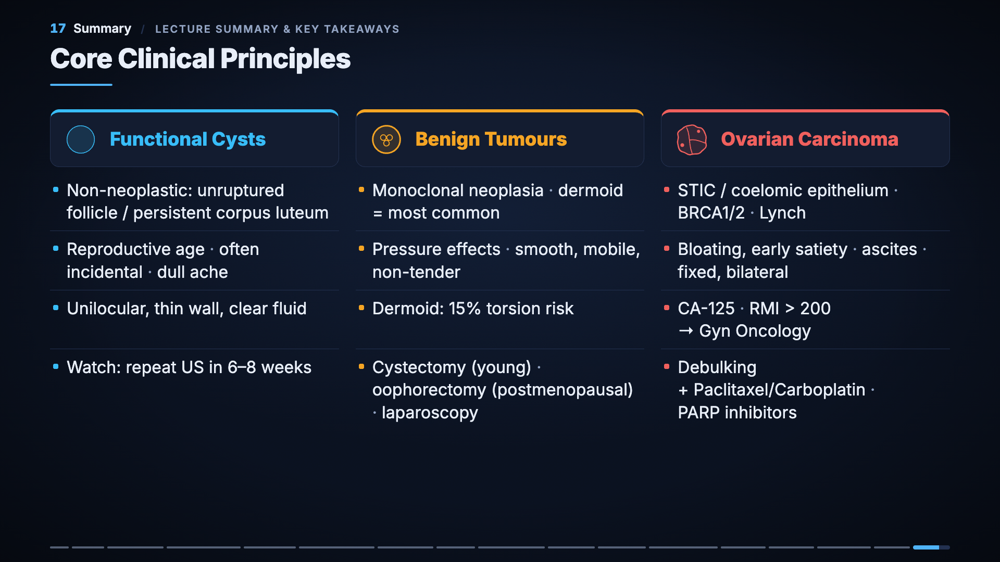

# Benign and Malignant Ovarian Tumours — study video

A narrated, animated walkthrough (22 min, English, captioned) of the lecture **"Benign and Malignant Ovarian Tumours"**
by **Dr. Iman Nabil, MRCOG** (A. Professor of Obstetrics and Gynecology), referenced to *Williams Obstetrics & Gynaecology*.

## ▶ Watch / download
**[Download the video (MP4, 130 MB)](https://github.com/faisalalsulmi1-prog/ovarian-tumours-study-video/releases/latest/download/Ovarian-Tumours.mp4)**

## Chapters
```
 0:00  01 Introduction
 0:29  02 Roadmap
 1:20  03 Differential Diagnosis
 2:49  04 Classification
 4:46  05 Epithelial Carcinomas
 6:09  06 Compare: Etiology
 8:08  07 Compare: Clinical Features
 9:36  08 Dermoid Cyst
10:37  09 Tumour Markers & RMI
12:23  10 Ultrasound
13:37  11 Management
14:52  12 FIGO Staging
16:41  13 Case 1
17:51  14 Case 2
19:03  15 Case 3
20:28  16 Case 4
21:25  17 Summary
```

## Cheat sheet


## Notes
- All on-screen content comes from the lecture slides. Notes tagged **"Beyond the slide"** (violet, dashed) are added explanations or cautions, not lecture content.
- Two lecture inconsistencies are flagged in the video: slide 11 lists "low resistance" Doppler under both benign and malignant features, and slide 14's staging figure does not match slide 13 (use slide 13).
- A study aid made from lecture slides, not an official course resource. Lecture figures belong to their sources (Williams Gynecology / McGraw-Hill, Pathweb).
